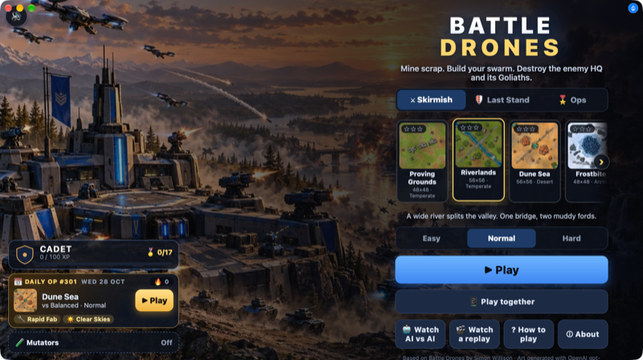

<h1 align="center">Battle Drones</h1>

Simon Willison's Battle Drones: a drone war for up to four, with phones as controllers.

&nbsp;&nbsp;

## Make Battle Drones yours

Each opens Lamp with a copy of Battle Drones and that change, ready to send:

- [Play on our TV with phones](https://lamp.dev/?repo=https://github.com/lampdotdev/battledrones&from=readme&ask=Play%20on%20our%20TV%20with%20phones)
- [Make it a lot more fun](https://lamp.dev/?repo=https://github.com/lampdotdev/battledrones&from=readme&ask=Make%20it%20a%20lot%20more%20fun)
- [Set it on the Moon](https://lamp.dev/?repo=https://github.com/lampdotdev/battledrones&from=readme&ask=Set%20it%20on%20the%20Moon)

## Open it in Lamp

[Lamp](https://lamp.dev) is a Mac app that builds apps from a description and changes them as you ask. [Open Battle Drones in Lamp](https://lamp.dev/?repo=https://github.com/lampdotdev/battledrones&from=readme) for a copy of your own, to use and to change as you like, with the credits below kept. Or, in Lamp, choose File → Open from GitHub… and paste `https://github.com/lampdotdev/battledrones`.

## Building it

Lamp builds this kind of app: it needs Xcode and signing on your Mac, which Lamp sets up. Open it in Lamp, above.

## Credits

- Based on [Battle Drones](https://github.com/simonw/battledrones) by Simon Willison, Apache-2.0, at commit `ca4f13b36013` (license: `LICENSE-battledrones`)
- Uses [qrcode-generator](https://github.com/kazuhikoarase/qrcode-generator) by Kazuhiko Arase, MIT (license: `LICENSE-qrcode-generator`)

## License

MIT. See [LICENSE](LICENSE).
